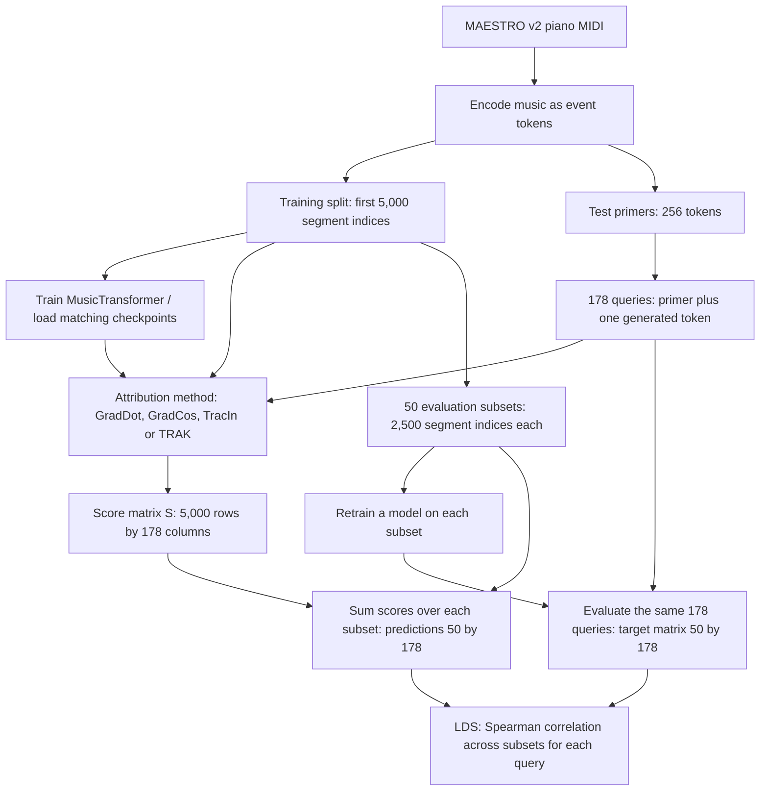

# Step 2: Understand the MAESTRO attribution benchmark

## The question

For a particular generated music event, which training segments influenced the model's prediction? An attribution method produces scores; LDS evaluates whether those scores predict the behavior of models retrained on subsets.

## Pipeline diagram

## Read the dimensions

| Object | Shape | Meaning |
|---|---|---|
| Training pool | 5,000 segment indices | First 5,000 indices from the processed training dataset, not 5,000 songs |
| Queries | 178 sequences of 257 tokens | 256-token context followed by one generated event |
| Attribution S | 5,000 x 178 | S[i,j] is the method's score for training segment i and query j |
| Evaluation subset indices | 50 x 2,500 | Each row identifies half of the training pool |
| Retrained-model targets | 50 x 178 | Actual query target values measured from subset-trained models |
| Subset score sums | 50 x 178 | Predicted subset behavior from attribution scores |
| LDS | 178 correlations | One correlation per query, usually summarized across valid queries |

Music tokens encode note-on, note-off, time shifts, and velocity. The model has 390 output classes: 388 musical event types plus END and PAD. A token is not a whole song or necessarily a note.

## One query, step by step

1. Take query j: a 256-token primer and its generated next event.
2. An attribution method scores each of the 5,000 training segments for that query. This is column j of S.
3. For evaluation subset b, add its 2,500 scores: prediction[b,j] = sum(S[i,j] for i in subset[b]).
4. Independently, a model trained on those 2,500 segments produces the actual target value for query j.
5. Repeat across 50 subsets. Spearman correlation compares the ranking of the 50 predictions with the ranking of the 50 actual target values.

High positive LDS means the scores predict subset behavior well under this protocol. Near-zero LDS means weak rank agreement; negative LDS means reversed agreement. Constant predictions or targets give undefined correlation. These scores are method-dependent values, not probabilities or ownership shares.

Toy illustration: if three subsets have score sums [2, 8, 5] and actual target values [0.1, 0.9, 0.4], both rank the subsets first < third < second, so LDS is 1. This illustration is not a benchmark result.

## Source map for your checkout

- `vendor/dattri/dattri/benchmark/load.py`: SAMPLERSIZE_MAP and prefix samplers establish 5,000 and 178; artifact paths and model loading.
- `vendor/dattri/dattri/benchmark/datasets/maestro/data.py`: dataset construction and generated-query selection.
- `vendor/dattri/dattri/benchmark/models/MusicTransformer/dataset/preprocess_midi.py`: MIDI-to-token preprocessing.
- `vendor/dattri/dattri/benchmark/models/MusicTransformer/dataset/e_piano.py`: segment indexing and input/target slicing.
- `vendor/dattri/dattri/benchmark/datasets/maestro/maestro_musictransformer.py`: model factory, training, query evaluation.
- `vendor/dattri/dattri/metric/metrics.py`: subset score sums and per-query Spearman correlation.
- `vendor/dattri/dattri/algorithm/tracin.py` and `trak.py`: attribution implementations.

## Details to preserve when experimenting

- Row identity and query order must agree across scores, subset indices, and target values. Matching shapes alone is insufficient.
- The inspected training/evaluation path uses final-token cross-entropy, rather than evaluating a complete generated song.
- Preserve target sign: the loss callback returns negative cross-entropy, and ground-truth construction applies another negation. Consume released targets unchanged when reproducing them.
- The offset-zero training-segment path can randomly crop a long performance. Our Step 1 smoke script reproduced this. Nominal segment indices do not always identify fixed token contents.
- Released half-model subset memberships overlap the released LDS evaluation subsets in the earlier artifact audit. A new experiment should explicitly separate attribution-construction subsets from evaluation subsets.
- ARIA comes after score generation: it inspects the structure of S. It supplements LDS; it does not require the subset retraining used by LDS.

## Evidence and scope

Source checkout revision: ef50a35e6cdfa358ca104b7655ef15dcb9650afe, matching the Step 1 setup.
The 5,000/178 configuration is confirmed in source code. Query lengths and released tensor dimensions are from the prior local artifact audit at Hugging Face revision 6ed5e60e2569fc7df4f0738ba44d446b7911a86f, preserved in the ChatGPT project mirror's output/artifact_audit.json and output/COMPONENT_GUIDE.md. These artifacts were not newly downloaded into whiteboard for Step 2. Full pretrained attribution has not been run.

Step 2 deliverable: this pipeline diagram and explanation. Step 3: reproduce subset score sums and LDS on small synthetic matrices before running the full benchmark.
